# BÁO CÁO THIẾT KẾ KIẾN TRÚC HỆ THỐNG
## HỆ THỐNG THƯƠNG MẠI ĐIỆN TỬ THỜI TRANG CAO CẤP TÍCH HỢP AI (AETHELGARD MALL)

---

## 🏗️ I. TỔNG QUAN KIẾN TRÚC HỆ THỐNG

Hệ thống được xây dựng theo mô hình **Client-Server hiện đại**, tách biệt hoàn toàn giữa tầng hiển thị (**Frontend SPA/SSR**) và tầng dịch vụ nghiệp vụ (**Backend RESTful API**), giao tiếp thông qua giao thức bảo mật HTTP/HTTPS và định dạng chuẩn JSON.

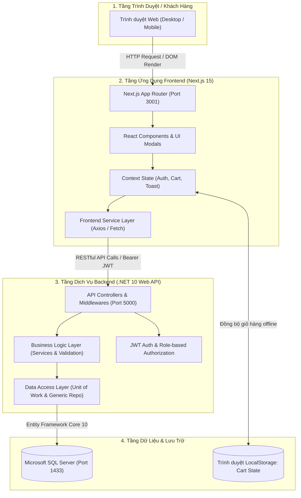

---

## 🏛️ II. KIẾN TRÚC CODE (SOFTWARE DESIGN & CODE ARCHITECTURE)

### 1. Kiến trúc Backend (.NET Clean Architecture / 3-Tier Pattern)
Mã nguồn Backend được tổ chức thành 4 phân tầng độc lập nhằm đảm bảo tính đơn nhiệm (Single Responsibility), dễ bảo trì và dễ mở rộng:

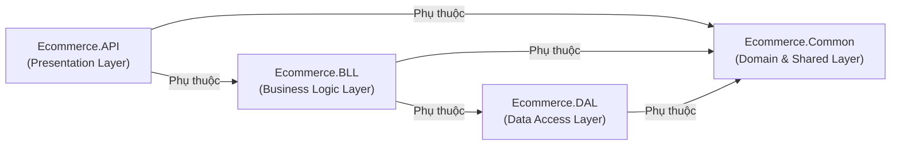

* **`Ecommerce.API` (Presentation Layer)**:
  - Tiếp nhận các HTTP Request, điều phối routing, xác thực JWT Token qua Middleware.
  - Các Controllers: `AuthController`, `ProductsController`, `OrdersController`, `InventoryAndStatsControllers`, `StoresAndSeedControllers`.
  - Kiểm soát lỗi tập trung thông qua Custom Exception Middleware và tích hợp Swagger OpenAPI.
* **`Ecommerce.BLL` (Business Logic Layer)**:
  - Chứa đựng toàn bộ luật nghiệp vụ (Business Rules), tính toán tồn kho, kiểm tra chống bán khống, xử lý đối soát tài chính và trợ lý thời trang `AIService`.
  - Các Services: `AuthService`, `ProductService`, `OrderService`, `InventoryService`, `StatisticsService`, `StoreService`, `AIService`.
  - Chuyển đổi dữ liệu tự động giữa Entity và DTO thông qua **AutoMapper**.
* **`Ecommerce.DAL` (Data Access Layer)**:
  - Tương tác với cơ sở dữ liệu qua **Entity Framework Core**.
  - Triển khai mẫu thiết kế **Generic Repository Pattern** (`IGenericRepository<T>`) và **Unit of Work Pattern** (`IUnitOfWork`) giúp quản lý Transaction nguyên tử (ACID).
  - Cấu hình quan hệ bảng, chỉ mục (Index), khóa ngoại (Foreign Key) bằng Fluent API trong `EntityConfigurations.cs`.
* **`Ecommerce.Common` (Domain Entities & Shared)**:
  - Khai báo các thực thể cốt lõi: `User`, `Store`, `Product`, `ProductVariant`, `Category`, `Order`, `OrderItem`, `TransactionRecord`.
  - Định nghĩa Enums (`UserRole`, `OrderStatus`, `PaymentStatus`, `StockStatus`) và các DTOs trao đổi dữ liệu.

---

### 2. Kiến trúc Frontend (Next.js 15 Component-Driven & Context Architecture)
Frontend tuân thủ chặt chẽ nguyên lý Component-Driven, phân tách rõ giao diện và tầng kết nối dữ liệu:

```
frontend/src/
├── app/                      # App Router (Next.js 15)
│   ├── page.tsx              # Trang chủ / Lưới sản phẩm & Phân trang
│   ├── login/                # Màn hình Đăng nhập / Đăng ký / Quên MK
│   ├── product-detail/[id]/  # Trang chi tiết sản phẩm chuẩn Boutique
│   ├── shop-profile/         # Trang hồ sơ thương hiệu Flagship
│   ├── orders/               # Phân hệ quản lý đơn hàng của Seller
│   ├── inventory/            # Phân hệ quản lý tồn kho & hàng hóa
│   └── income-statistics/    # Phân hệ thống kê doanh thu & tài chính
├── components/               # Tái sử dụng giao diện
│   ├── Navbar.tsx            # Thanh điều hướng thích ứng phân quyền
│   ├── Footer.tsx            # Chân trang Luxury
│   └── seller/               # Bộ Modal & Drawer (Cart, Checkout, Drawer)
├── contexts/                 # Quản lý State toàn cục
│   ├── AuthContext.tsx       # Quản lý phiên JWT, User Info, Phân quyền
│   ├── CartContext.tsx       # Giỏ hàng toàn cục, đồng bộ LocalStorage
│   └── ToastContext.tsx      # Thông báo Toast Popup tương tác
└── services/                 # Tầng giao tiếp RESTful API
    ├── auth.service.ts
    ├── product.service.ts
    └── order.service.ts
```

---

## 📊 III. BIỂU ĐỒ PHÂN RÃ CHỨC NĂNG (FUNCTIONAL DECOMPOSITION DIAGRAM - FDD)

Hệ thống được phân rã thành 4 khối chức năng chính:

```mermaid
flowchart TD
    Root["HỆ THỐNG TMĐT THỜI TRANG AETHELGARD MALL"]

    SubBuyer["Phân Hệ Người Mua<br/>(Customer / Guest)"]
    SubSeller["Phân Hệ Người Bán<br/>(Seller / Merchant)"]
    SubAdmin["Phân Hệ Quản Trị<br/>(System Admin)"]
    SubCommon["Phân Hệ Chung<br/>(Core Services)"]

    Root --> SubBuyer
    Root --> SubSeller
    Root --> SubAdmin
    Root --> SubCommon

    %% Customer Functions
    F_Catalog["Khám Phá & Tìm Kiếm<br/>(Bộ lọc, Sort, Phân trang 12sp)"]
    F_Detail["Xem Chi Tiết Boutique<br/>(Size, Màu, AI Stylist)"]
    F_Cart["Quản Lý Giỏ Hàng<br/>(Thêm/Bớt/Xóa, LocalStorage)"]
    F_Checkout["Đặt Hàng & Thanh Toán<br/>(COD, Chuyển khoản, Check Kho)"]
    F_Store["Xem Gian Hàng Đối Tác<br/>(Voucher, Bản đồ Maps)"]
    SubBuyer --> F_Catalog
    SubBuyer --> F_Detail
    SubBuyer --> F_Cart
    SubBuyer --> F_Checkout
    SubBuyer --> F_Store

    %% Seller Functions
    S_Inv["Quản Lý Kho Hàng<br/>(KPI kho, Bảng SKU, Nhập hàng)"]
    S_Order["Quản Lý Đơn Hàng<br/>(KPI đơn, Drawer vận đơn, Đổi status)"]
    S_Finance["Báo Cáo Tài Chính<br/>(Biểu đồ tháng, Gauge, Lịch sử)"]
    S_Brand["Quản Trị Gian Hàng<br/>(Trưng bày bộ sưu tập riêng)"]
    SubSeller --> S_Inv
    SubSeller --> S_Order
    SubSeller --> S_Finance
    SubSeller --> S_Brand

    %% Admin Functions
    A_User["Quản Lý Người Dùng<br/>(Phân quyền, Khóa/Mở)"]
    A_Store["Quản Lý Cửa Hàng & Đối Tác"]
    A_Category["Quản Lý Danh Mục Sàn"]
    A_Seed["Khởi Tạo Dữ Liệu Seeder"]
    SubAdmin --> A_User
    SubAdmin --> A_Store
    SubAdmin --> A_Category
    SubAdmin --> A_Seed

    %% Common Functions
    C_Auth["Xác Thực JWT & Đăng Nhập"]
    C_OTP["Khôi Phục Mật Khẩu OTP"]
    C_Audit["Kiểm Soát Quyền Sở Hữu"]
    SubCommon --> C_Auth
    SubCommon --> C_OTP
    SubCommon --> C_Audit
```

---

## 🎯 IV. CÁC BIỂU ĐỒ USE CASE (USE CASE DIAGRAMS)

### 1. Biểu đồ Use Case Tổng quát Toàn Hệ thống
Xác định 3 tác nhân chính: **Khách hàng (Customer)**, **Người bán (Seller)**, và **Quản trị viên (Admin)**.

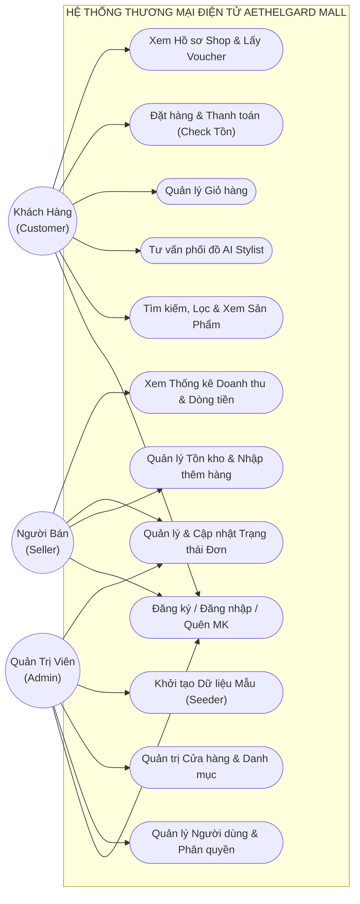

---

### 2. Biểu đồ Use Case Chi tiết Phân hệ Người mua (Customer)

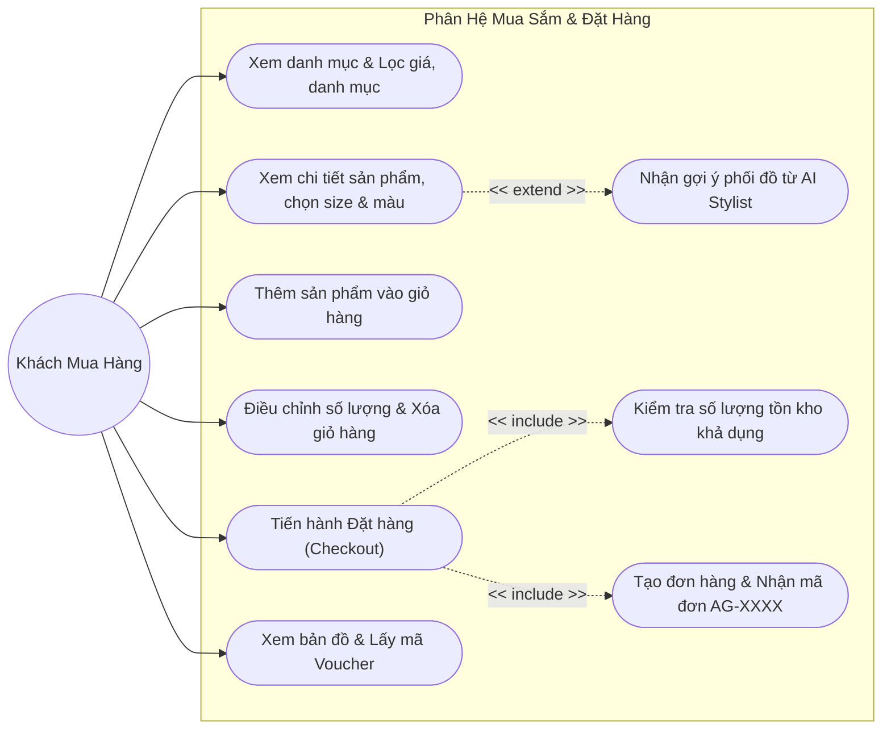

---

### 3. Biểu đồ Use Case Chi tiết Phân hệ Người bán (Seller)

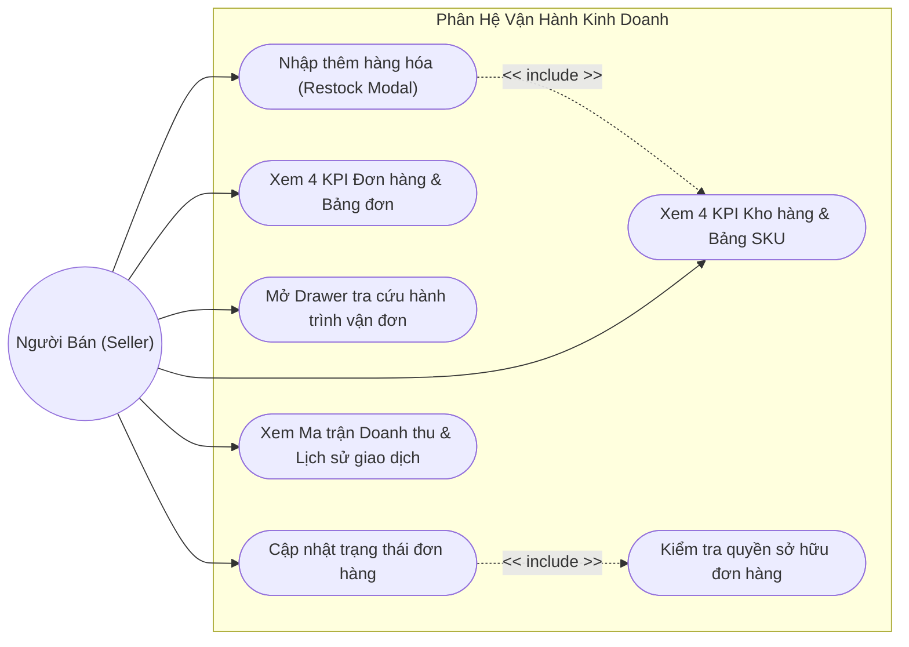

---

## 🗄️ V. BIỂU ĐỒ THỰC THỂ QUAN HỆ (ENTITY RELATIONSHIP DIAGRAM - ERD)

Mô hình dữ liệu quan hệ được chuẩn hóa theo chuẩn 3NF, cấu hình bằng EF Core Fluent API:

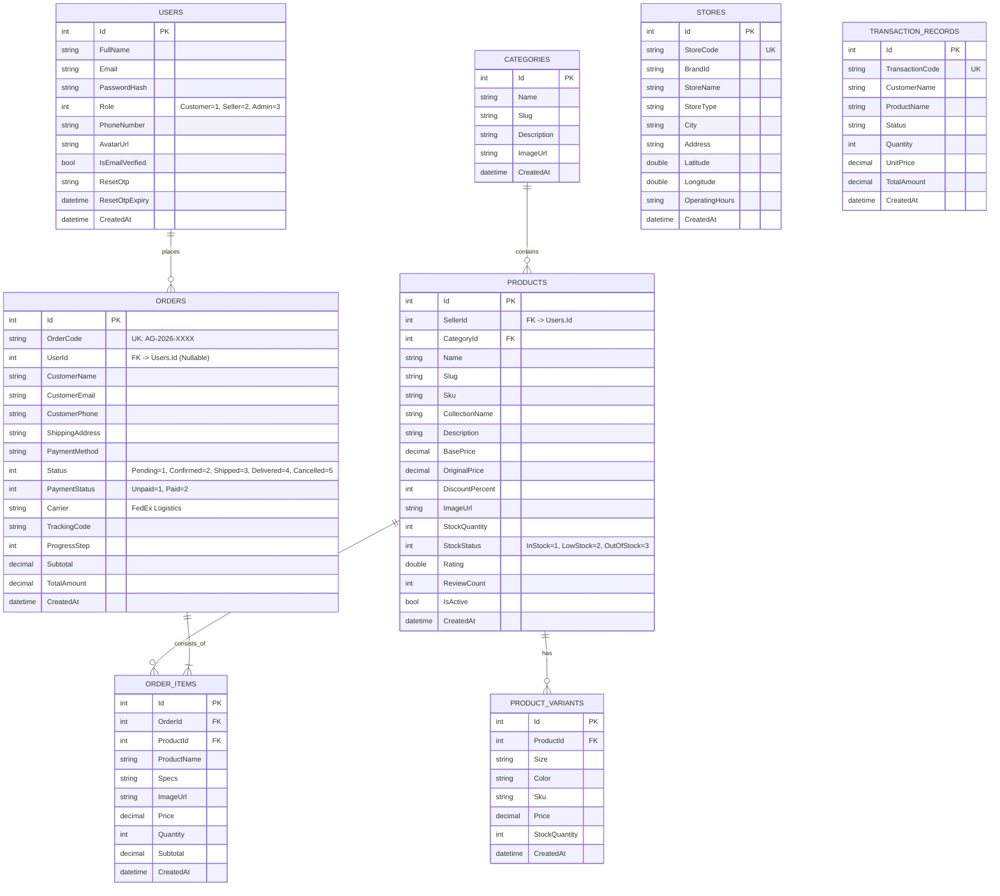

---

## ⏱️ VI. CÁC BIỂU ĐỒ TUẦN TỰ (SEQUENCE DIAGRAMS)

### 1. Luồng Xác thực & Đăng nhập Người dùng (JWT Authentication)
Minh họa quá trình đăng nhập và gắn quyền truy cập:

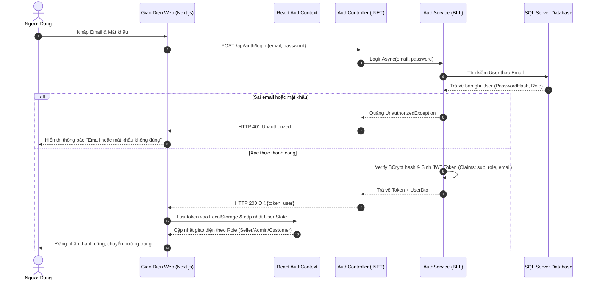

---

### 2. Luồng Khách hàng Đặt hàng & Khóa tồn kho chống bán khống (Order Checkout & Anti-Overselling Guard)
Đây là nghiệp vụ quan trọng nhất bảo vệ tính toàn vẹn kho hàng của sàn thương mại điện tử:

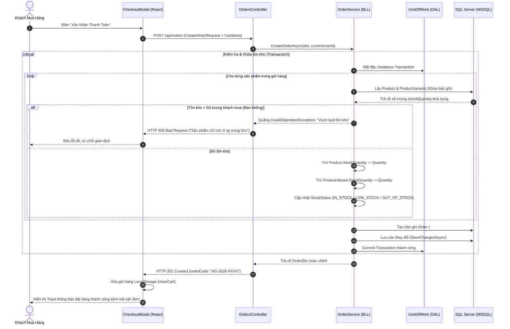

---

### 3. Luồng Người bán Nhập thêm hàng vào kho (Restock Inventory)

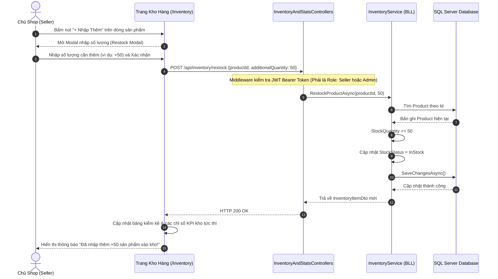

---

### 4. Luồng Cập nhật Trạng thái Đơn hàng & Tra cứu Vận chuyển

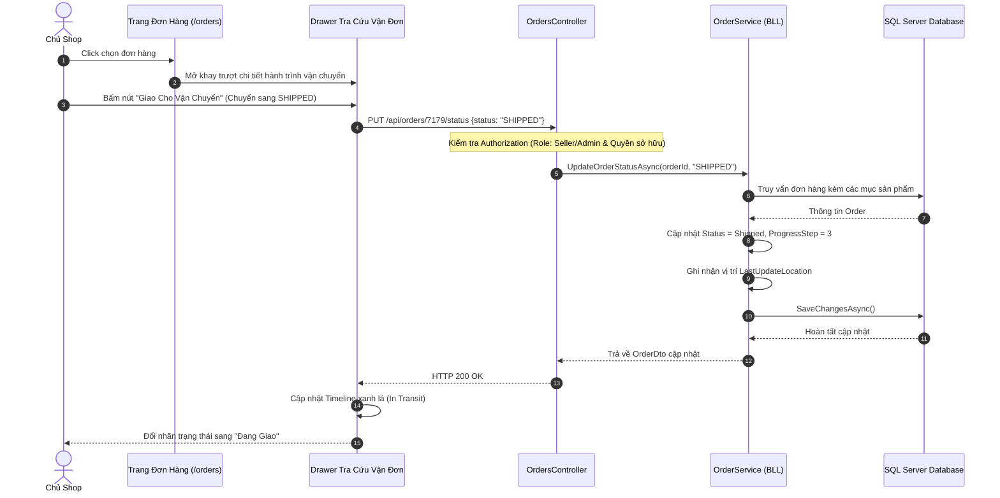

---

## 🌐 VII. BIỂU ĐỒ KIẾN TRÚC TRIỂN KHAI (DEPLOYMENT DIAGRAM)

Mô hình kiến trúc triển khai trên môi trường máy chủ vật lý / máy phát triển cục bộ:

```mermaid
flowchart TD
    subgraph ClientDevice ["Thiết Bị Người Dùng (Client Machine)"]
        Browser["Trình Duyệt Web (Chrome / Safari / Edge)<br/>Chạy giao diện HTML5, CSS3, JavaScript"]
    end

    subgraph HostServer ["Máy Chủ Ứng Dụng (Application Host)"]
        subgraph NodeRuntime ["Node.js Runtime Engine"]
            NextServer["Next.js 15 Server (Port 3001)<br/>• SSR Page Rendering<br/>• Static Asset Serving<br/>• Proxy Routing"]
        end

        subgraph DotNetRuntime [".NET 10 CLR Runtime Engine"]
            Kestrel["Kestrel Web Server (Port 5000)<br/>• ASP.NET Core Web API<br/>• JWT Authentication Filter<br/>• Swagger UI Docs (/swagger)"]
        end

        subgraph DatabaseInstance ["Cơ Sở Dữ Liệu Quan Hệ"]
            MSSQLServer["Microsoft SQL Server (Port 1433)<br/>• Database: EcommerceAethelgardDb<br/>• Tables: Users, Products, Orders...<br/>• ACID Transactions & Indexing"]
        end
    end

    Browser <-->|HTTP / WebSocket (Port 3001)| NextServer
    Browser <-->|AJAX / RESTful API (Port 5000)| Kestrel
    Kestrel <-->|TCP/IP ADO.NET Connection (Port 1433)| MSSQLServer
```

