# BÁO CÁO THIẾT KẾ KIẾN TRÚC HỆ THỐNG
## HỆ THỐNG THƯƠNG MẠI ĐIỆN TỬ THỜI TRANG CAO CẤP TÍCH HỢP AI (AETHELGARD MALL)

---

## 🏗️ I. TỔNG QUAN KIẾN TRÚC HỆ THỐNG

Hệ thống được thiết kế theo mô hình **Client-Server hiện đại, phân tán và hướng dịch vụ**, tách biệt hoàn toàn giữa tầng giao diện người dùng (**Frontend SPA/SSR**) và tầng xử lý nghiệp vụ (**Backend RESTful API**). Toàn bộ hệ thống được container hóa thông qua **Docker & Docker Compose**, đảm bảo tính nhất quán trên môi trường phát triển và sản xuất.

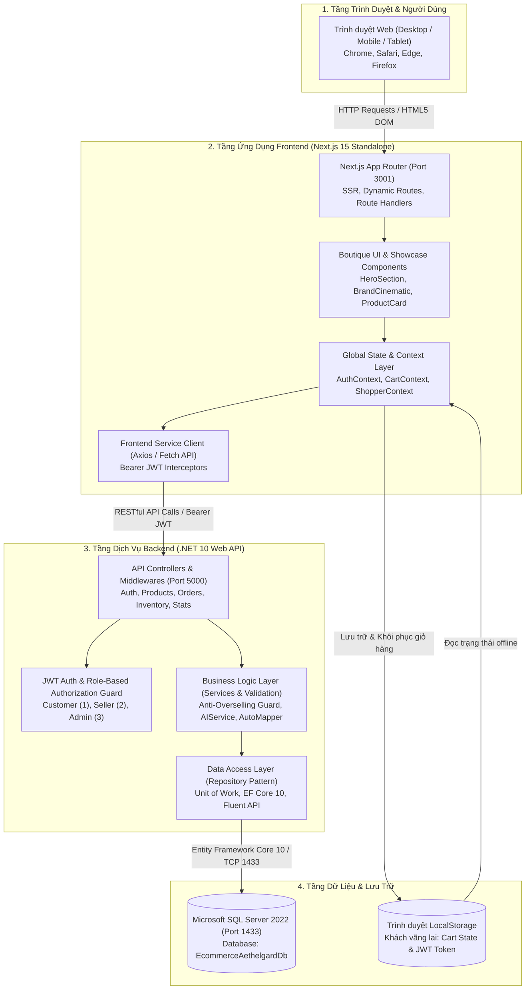

---

## 🏛️ II. KIẾN TRÚC PHẦN MỀM (SOFTWARE DESIGN & CODE ARCHITECTURE)

### 1. Kiến trúc Backend (.NET Clean Architecture / 4-Tier Pattern)
Mã nguồn Backend được phân tách thành 4 tầng riêng biệt nhằm tuân thủ nguyên lý đơn nhiệm (Single Responsibility Principle) và khả năng mở rộng cao:

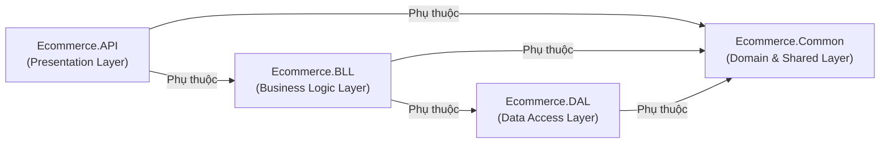

* **`Ecommerce.API` (Presentation Layer)**:
  - Tiếp nhận các HTTP Request, xử lý định tuyến (Routing), kiểm tra token qua JWT Middleware.
  - Controllers chính: `AuthController`, `ProductsController`, `OrdersController`, `InventoryAndStatsControllers`, `StoresAndSeedControllers`.
  - Kiểm soát lỗi tập trung với Custom Exception Handling Middleware và tích hợp tài liệu OpenAPI Swagger tại `/swagger`.
* **`Ecommerce.BLL` (Business Logic Layer)**:
  - Xử lý toàn bộ nghiệp vụ cốt lõi: thuật toán trừ tồn kho chống bán khống (Anti-Overselling), quản lý đơn hàng đa trạng thái, đối soát tài chính và trợ lý thời trang thông minh `AIService`.
  - Các Services: `AuthService`, `ProductService`, `OrderService`, `InventoryService`, `StatisticsService`, `StoreService`, `AIService`.
  - Tự động chuyển đổi dữ liệu thông qua thư viện **AutoMapper**.
* **`Ecommerce.DAL` (Data Access Layer)**:
  - Tương tác với SQL Server thông qua **Entity Framework Core 10**.
  - Áp dụng mẫu thiết kế **Generic Repository Pattern** (`IGenericRepository<T>`) và **Unit of Work Pattern** (`IUnitOfWork`), bảo đảm tính toàn vẹn giao dịch (ACID).
  - Cấu hình quan hệ bảng, khóa ngoại, chỉ mục hiệu năng cao bằng Fluent API trong `EntityConfigurations.cs`.
* **`Ecommerce.Common` (Domain Entities & Shared Core)**:
  - Chứa các thực thể Domain: `User`, `Store`, `Product`, `ProductVariant`, `Category`, `Order`, `OrderItem`, `Review`, `TransactionRecord`.
  - Định nghĩa các Enum chuẩn: `UserRole` (Customer, Seller, Admin), `OrderStatus`, `PaymentStatus`, `StockStatus`.

---

### 2. Kiến trúc Thành phần Frontend (Next.js 15 Component & State Architecture)
Thay vì cây thư mục dạng text, kiến trúc Frontend được trực quan hóa qua biểu đồ phân lớp thành phần và luồng dữ liệu như sau:

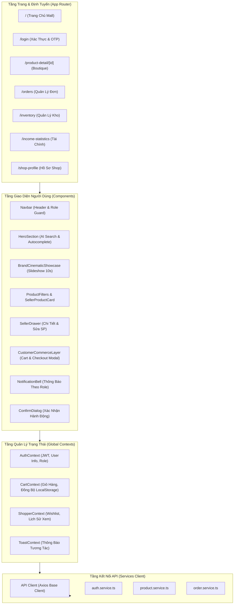

---

### 3. Kiến trúc Luồng Dữ liệu Toàn cục (Global State Flow)
Biểu đồ mô tả sự tương tác giữa các Context trong ứng dụng:

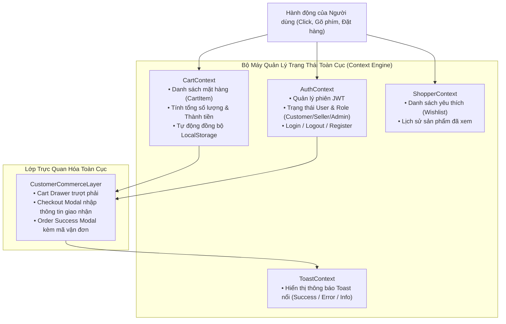

---

## 📊 III. BIỂU ĐỒ PHÂN RÃ CHỨC NĂNG (FUNCTIONAL DECOMPOSITION DIAGRAM - FDD)

Hệ thống được phân rã thành 4 phân hệ chính:

```mermaid
flowchart TD
    Root["HỆ THỐNG TMĐT THỜI TRANG CAO CẤP AETHELGARD MALL"]

    SubBuyer["Phân Hệ Người Mua<br/>(Customer / Guest)"]
    SubSeller["Phân Hệ Người Bán<br/>(Seller / Merchant)"]
    SubAdmin["Phân Hệ Quản Trị<br/>(System Admin)"]
    SubCommon["Phân Hệ Hạ Tầng & Bảo Mật<br/>(Core Services & DevOps)"]

    Root --> SubBuyer
    Root --> SubSeller
    Root --> SubAdmin
    Root --> SubCommon

    %% Customer Functions
    F_Search["Tìm Kiếm & Gợi Ý AI<br/>(Autocomplete, Thẻ Tag, Lọc Danh Mục)"]
    F_Cinema["Trưng Bày Cinematic Runway<br/>(Slideshow 14 Thương Hiệu Xa Xỉ)"]
    F_Detail["Trang Chi Tiết Boutique<br/>(Chọn Size/Màu, AI Stylist, Đánh Giá)"]
    F_Cart["Quản Lý Giỏ Hàng<br/>(Cập Nhật SL, Đồng Bộ LocalStorage)"]
    F_Checkout["Thanh Toán An Toàn<br/>(COD, Chuyển Khoản, Khóa Tồn Kho)"]
    F_Noti["Thông Báo Đơn Hàng Khách<br/>(Kênh Riêng Biệt Cho Khách)"]
    SubBuyer --> F_Search
    SubBuyer --> F_Cinema
    SubBuyer --> F_Detail
    SubBuyer --> F_Cart
    SubBuyer --> F_Checkout
    SubBuyer --> F_Noti

    %% Seller Functions
    S_Inv["Quản Lý Kho Hàng<br/>(4 KPI Kho, Bảng SKU, Restock Hàng)"]
    S_Order["Quản Lý Đơn Hàng<br/>(Tra Cứu Vận Đơn, Đổi Trạng Thái)"]
    S_Finance["Báo Cáo Doanh Thu<br/>(Ma Trận Dòng Tiền, Gauge Lợi Nhuận)"]
    S_Brand["Quản Trị Hồ Sơ Gian Hàng<br/>(Trưng Bày Bộ Sưu Tập Riêng)"]
    SubSeller --> S_Inv
    SubSeller --> S_Order
    SubSeller --> S_Finance
    SubSeller --> S_Brand

    %% Admin Functions
    A_User["Quản Trị Người Dùng<br/>(Phân Quyền RBAC, Khóa/Mở)"]
    A_Store["Quản Trị Gian Hàng & Đối Tác"]
    A_Cat["Quản Trị Danh Mục Hệ Thống"]
    A_Seed["Khởi Tạo Dữ Liệu Seeder 20 Luxury"]
    SubAdmin --> A_User
    SubAdmin --> A_Store
    SubAdmin --> A_Cat
    SubAdmin --> A_Seed

    %% Common Functions
    C_Auth["Xác Thực Đa Tầng JWT Token"]
    C_RBAC["Middleware Kiểm Soát Quyền Sở Hữu"]
    C_Docker["Container Hóa Đa Dịch Vụ Docker"]
    SubCommon --> C_Auth
    SubCommon --> C_RBAC
    SubCommon --> C_Docker
```

---

## 🎯 IV. CÁC BIỂU ĐỒ USE CASE (USE CASE DIAGRAMS)

### 1. Biểu đồ Use Case Tổng quát Toàn Hệ thống
Xác định 3 tác nhân chính: **Khách hàng (Customer)**, **Người bán (Seller)**, và **Quản trị viên (Admin)**.

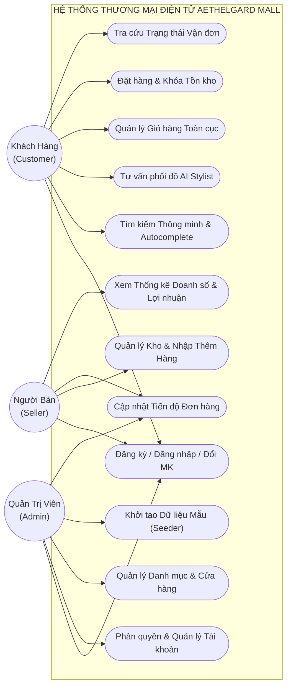

---

### 2. Biểu đồ Use Case Chi tiết Phân hệ Người mua (Customer)

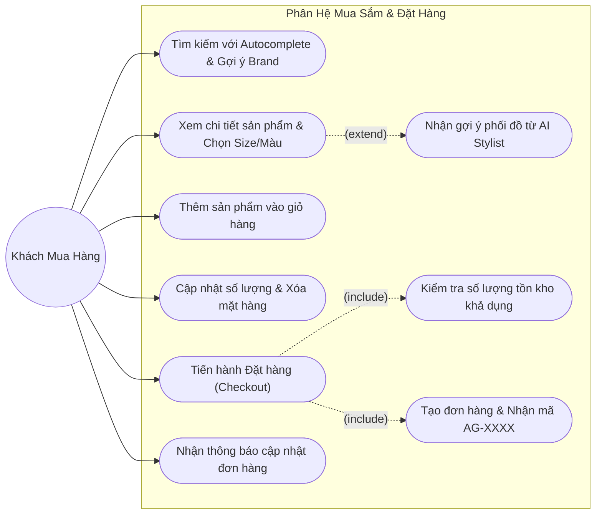

---

### 3. Biểu đồ Use Case Chi tiết Phân hệ Người bán (Seller)

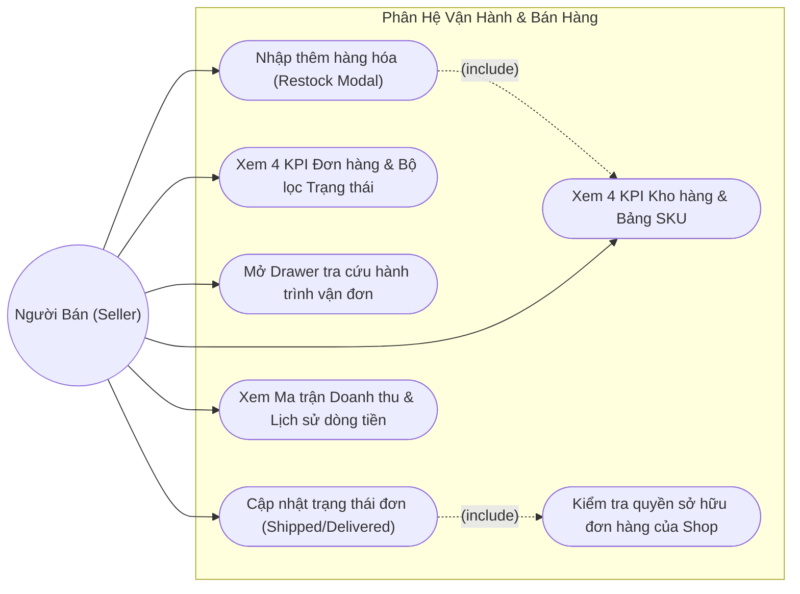

---

## 🗄️ V. BIỂU ĐỒ THỰC THỂ QUAN HỆ (ENTITY RELATIONSHIP DIAGRAM - ERD)

Mô hình dữ liệu quan hệ được chuẩn hóa theo chuẩn 3NF, phản ánh chính xác cấu trúc thực tế của hệ thống Database:

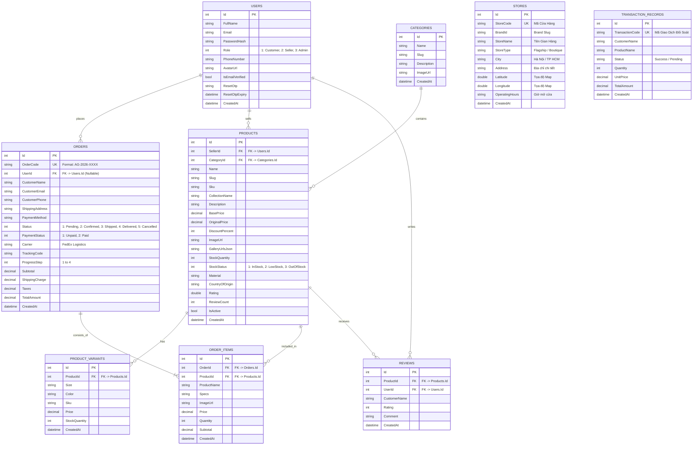

---

## ⏱️ VI. CÁC BIỂU ĐỒ TUẦN TỰ (SEQUENCE DIAGRAMS)

### 1. Luồng Xác thực Đăng nhập & Cấp phát Quyền (JWT Authentication & RBAC)

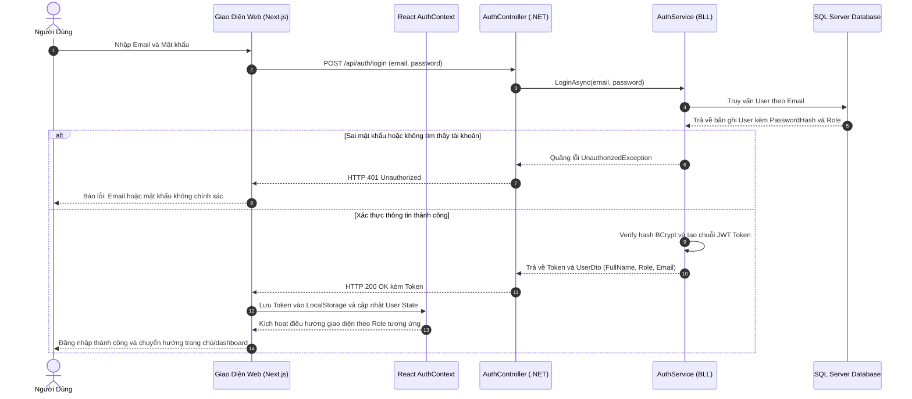

---

### 2. Luồng Tìm kiếm Thời gian thực & Gợi ý Thông minh (Real-time Autocomplete Search)

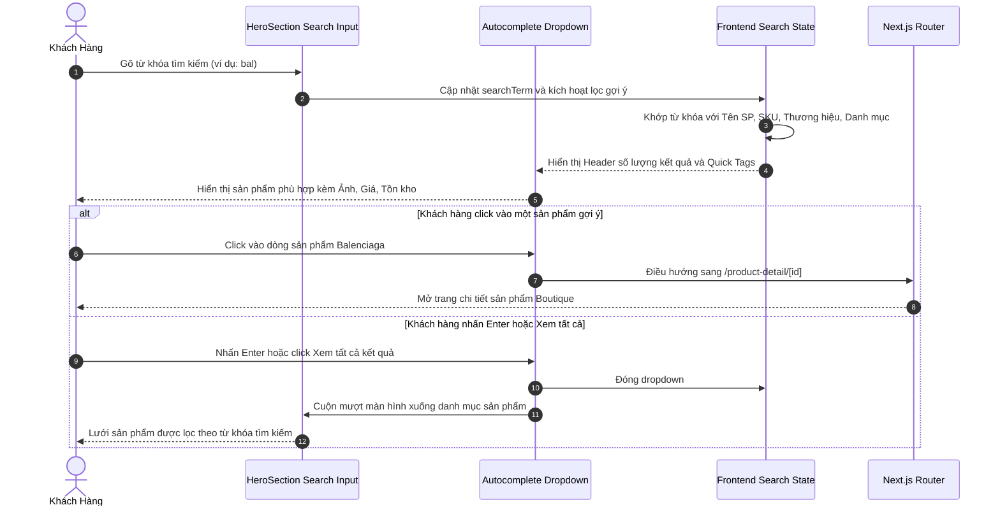

---

### 3. Luồng Khách hàng Đặt hàng & Khóa Tồn kho Chống Bán Khống (Anti-Overselling Guard)

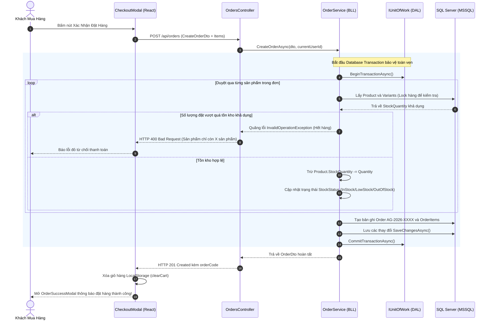

---

### 4. Luồng Người bán Nhập thêm hàng vào kho (Restock Inventory)

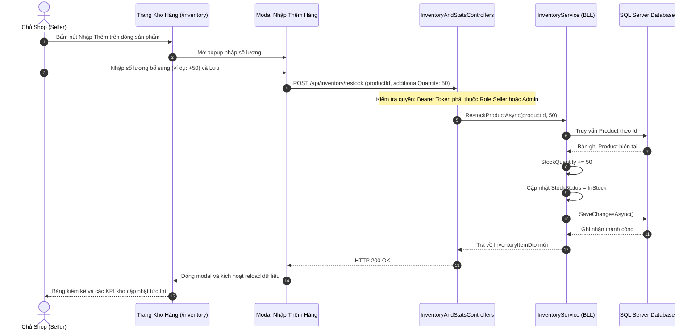

---

### 5. Luồng Cập nhật Trạng thái Đơn hàng & Tra cứu Vận chuyển

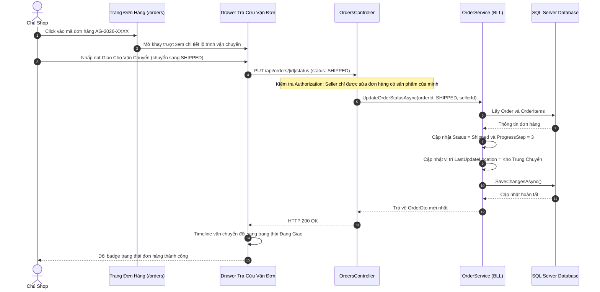

---

## 🌐 VII. KIẾN TRÚC ĐÓNG GÓI VÀ TRIỂN KHAI DOCKER (CONTAINERIZED DEPLOYMENT ARCHITECTURE)

Hệ thống được đóng gói hoàn chỉnh thành các Docker Container độc lập và quản lý tập trung thông qua **Docker Compose**:

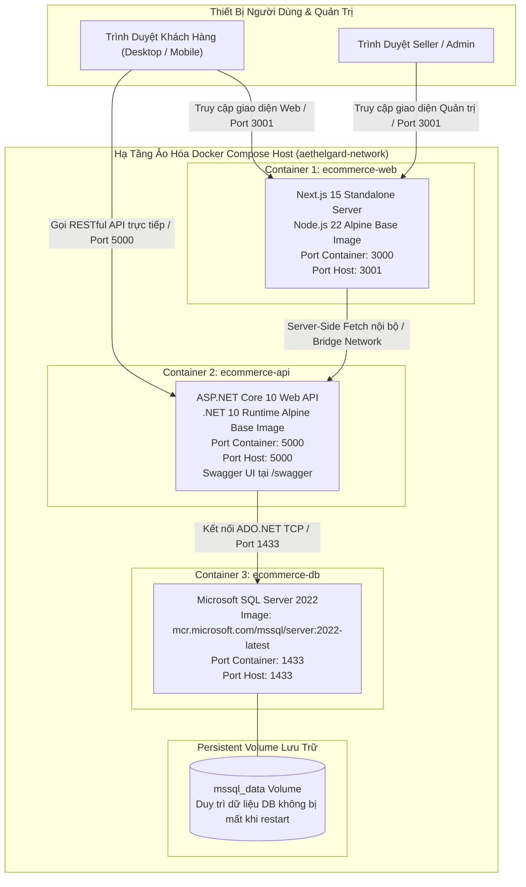

### 1. Chi tiết cấu hình các dịch vụ Docker Compose:
| Tên Dịch Vụ | Base Image | Port Ánh Xạ (Host:Container) | Vai Trò | Phụ Thuộc (Depends On) |
|---|---|---|---|---|
| **`ecommerce-db`** | `mcr.microsoft.com/mssql/server:2022-latest` | `1433:1433` | Cơ sở dữ liệu quan hệ MSSQL, gắn volume `mssql_data` | Không |
| **`ecommerce-api`** | Multi-stage: SDK 10 Build $\to$ ASP.NET 10 Runtime | `5000:5000` | Cung cấp RESTful API, tự động migrate và seed DB | `ecommerce-db` |
| **`ecommerce-web`** | Multi-stage: Node 22 Build $\to$ Standalone Next.js | `3001:3000` | Giao diện thời trang AI khách hàng và Dashboard | `ecommerce-api` |

### 2. Lệnh khởi chạy và quản trị hệ thống:
* **Khởi động toàn bộ cụm dịch vụ**:
  ```bash
  docker compose up -d --build
  ```
* **Theo dõi nhật ký vận hành (Logs)**:
  ```bash
  docker compose logs -f ecommerce-api
  docker compose logs -f ecommerce-web
  ```
* **Dừng và giải phóng tài nguyên**:
  ```bash
  docker compose down
  ```

---

## 🛡️ VIII. MA TRẬN PHÂN QUYỀN TRUY CẬP (ROLE-BASED ACCESS CONTROL - RBAC)

Hệ thống thiết lập hàng rào bảo mật nghiêm ngặt 3 lớp giữa Khách hàng (Customer), Chủ shop (Seller), và Quản trị viên (Admin):

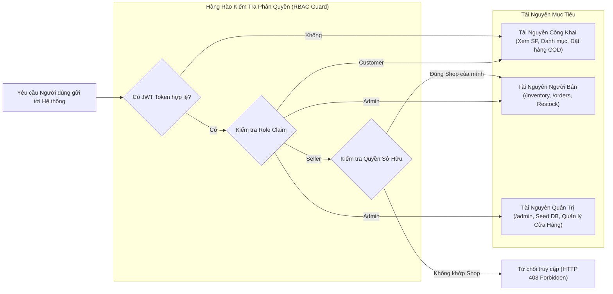

### Bảng Ma trận Phân quyền Chi tiết:

| Khu Vực / Tính Năng | Khách Vãng Lai (Guest) | Khách Hàng (Customer) | Người Bán (Seller) | Quản Trị Viên (Admin) |
|---|:---:|:---:|:---:|:---:|
| **Khám phá sản phẩm & Tìm kiếm AI** | ✅ Cho phép | ✅ Cho phép | ✅ Cho phép | ✅ Cho phép |
| **Xem chi tiết sản phẩm Boutique** | ✅ Cho phép | ✅ Cho phép | ✅ Cho phép | ✅ Cho phép |
| **Thêm vào giỏ & Đặt hàng** | ✅ Cho phép | ✅ Cho phép | ✅ Cho phép | ✅ Cho phép |
| **Kênh thông báo cá nhân** | ❌ Không | ✅ Thông báo Khách | ✅ Thông báo Shop | ✅ Toàn quyền |
| **Quản lý kho hàng (`/inventory`)** | ❌ Chặn | ❌ Chặn | ✅ Kho của Shop | ✅ Xem mọi kho |
| **Nhập thêm hàng hóa (Restock)** | ❌ Chặn | ❌ Chặn | ✅ Hàng của Shop | ✅ Mọi sản phẩm |
| **Đổi trạng thái đơn (`/orders`)** | ❌ Chặn | ❌ Chặn | ✅ Đơn thuộc Shop | ✅ Mọi đơn hàng |
| **Xem báo cáo tài chính (`/stats`)** | ❌ Chặn | ❌ Chặn | ✅ Shop của mình | ✅ Doanh thu toàn sàn |
| **Quản trị người dùng & Seed DB** | ❌ Chặn | ❌ Chặn | ❌ Chặn | ✅ Toàn quyền |

---

*Báo cáo được hoàn thiện và đồng bộ hóa tự động theo kiến trúc mã nguồn thực tế của dự án Aethelgard Mall.*
